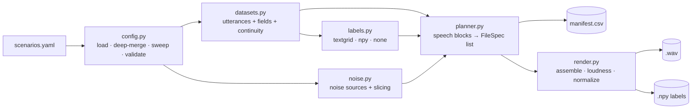

# Generalization Plan: Configurable Concat Scenarios

This plan replaces the hard-coded `LibriSpeechConcat` construction with a config-driven builder that:

1. supports the two target scenarios, **Noise + Audio** and **Audio + Noise**, with a configurable noise ratio, noise level and target duration;
2. works with corpora other than LibriSpeech, where consecutive files may not form a continuous recording;
3. reproduces the current paper dataset (`LibriVAD-Concat`) as one scenario among others.

The configuration format is specified in [`concat_scenarios.example.yaml`](concat_scenarios.example.yaml). This document covers how to implement it.

---

## 1. Current state and what blocks generalization

| Coupling | Where | Why it blocks |
| :--- | :--- | :--- |
| Layout fixed to `wav1 + silence + wav2` | [`create_LibriSpeechConcat.py:115`](../src/librivad/generation/creation_scripts/create_LibriSpeechConcat.py#L115) | No way to put the noise first or last. |
| Gap length fixed to `(len1 + len2) / 4` | [`create_LibriSpeechConcat.py:98`](../src/librivad/generation/creation_scripts/create_LibriSpeechConcat.py#L98), [`:179`](../src/librivad/generation/creation_scripts/create_LibriSpeechConcat.py#L179) | No configurable ratio and no target duration. |
| Gap gain fixed to `0.001` (absolute) | [`create_LibriSpeechConcat.py:115`](../src/librivad/generation/creation_scripts/create_LibriSpeechConcat.py#L115) | The level is not relative to the speech loudness. |
| Pairs are always `(0,1), (2,3), …` of sorted paths | [`create_LibriSpeechConcat.py:165`](../src/librivad/generation/creation_scripts/create_LibriSpeechConcat.py#L165) | Pairs cross speaker and chapter boundaries without any control. |
| Labels rebuilt from the `A_+_B.wav` filename and the same `/4` rule | [`create_labels.py:170`](../src/librivad/generation/creation_scripts/create_labels.py#L170) | Any new layout silently produces wrong labels. |
| Source paths parsed from the filename | [`validate.py:46`](../src/librivad/generation/validate.py#L46) | Same as above. |
| Label path inferred from `wav_path.parts[-5]` | [`librispeech_functions.remove_silence`](../src/librivad/generation/librispeech_functions.py#L148) | `create_LibriVAD.py` can only read labels laid out like LibriSpeech. |
| Speaker/chapter/utterance taken from path positions `parts[-3]`, `parts[-2]` | `librispeech_functions.find_alignment`, `create_labels.py` | Assumes the LibriSpeech folder structure. |
| Labels only from TextGrid forced alignments | `librispeech_functions.find_timeframes` | Other corpora ship RTTM, `.npy` or no labels at all. |

---

## 2. Design principles

- **Plan, then render.** First build a complete, serializable list of output files: their sources, segment bounds, noise offsets and gains. Then render the audio in parallel. The current script already pre-computes silence offsets for this reason (determinism under threads). Making the plan explicit also gives a `--dry-run` and the manifest for free.
- **Labels are written with the audio.** The `.npy` label is produced from the same plan that produced the `.wav`. The filename is no longer the source of truth, and the manifest records every segment boundary.
- **The corpus lives in config, not in code.** LibriSpeech becomes a `dataset:` block (path pattern, label source, continuity). There is no `if dataset == "LibriSpeech"` branch in the new modules.
- **The paper dataset is a regression test.** The `paper_middle` scenario must reproduce the existing `files/datasets/LibriSpeechConcat` output before any new scenario is trusted.
- **Old entry points keep working.** `create_LibriSpeechConcat.py`, `create_labels.py` and `setup.py` keep their current behavior until the new builder reaches parity. After that, they delegate to it.

---

## 3. Target architecture



New modules under `src/librivad/generation/`:

| Module | Responsibility | Main types / functions |
| :--- | :--- | :--- |
| `config.py` | Load the YAML, deep-merge each scenario over `defaults`, expand `sweep` into concrete variants, enforce the validation rules listed at the end of the YAML. | `load_config(path) -> Config`, `expand_variants(scenario) -> list[Variant]` |
| `datasets.py` | List the utterances of a split with their metadata fields, parsed from `path_pattern` or from a `manifest` CSV. Apply `exclude_list`. Group and order them by `continuity`. | `Utterance(path, split, fields, n_samples)`, `DatasetAdapter.utterances(split)`, `.continuity_groups(split)` |
| `labels.py` | Return a sample-level 0/1 array per utterance from `textgrid`, `npy` or `none`. Generalizes `find_timeframes` and `create_labels._generate_label_from_timeframes`. | `load_labels(utt, cfg) -> NDArray[int16]` |
| `noise.py` | Resolve noise sources. `extracted_from_dataset` generalizes `generate_silence_signal`. `file_per_split` covers `files/Noises`. Provides cursor-based `sequential_wrap` and seeded `random_offset` slicing. | `NoiseSource.slice(n_samples, rng_or_cursor) -> (offset, NDArray)` |
| `planner.py` | Build the speech blocks (`single` / `contiguous` / `concatenate`), compute the noise length from `noise_ratio`, apply the `overshoot_policy` and `leftover_policy`, assign noise offsets, and emit the `FileSpec`s. | `FileSpec(out_path, segments[], noise_offset, noise_level_db, …)`, `plan(variant, adapter, noise) -> list[FileSpec]` |
| `render.py` | Read the sources, join them with fades, measure the reference RMS on speech-only samples, scale the noise, concatenate in `layout` order, normalize, and write the `.wav`, `.npy` and manifest row. | `render(spec) -> ManifestRow` |
| `build_scenarios.py` | CLI entry point. | see §6 |

`librispeech_functions.py` stays as a compatibility layer. Its functions are re-implemented as thin wrappers over `labels.py` and `noise.py` once those exist, so the current creation scripts keep importing it.

---

## 4. Core rules (the parts that are easy to get wrong)

**Noise length from the ratio.** For speech block length `S` samples and ratio `p`:

```
noise_len = floor(S * p / (1 - p))
```

Compute it with `fractions.Fraction(p).limit_denominator()` and integer arithmetic. In floating point, `p / (1 - p)` is not exact for every ratio: `0.6 / 0.4` gives `1.4999999999999998`, so `int(S * r)` loses one sample for every even `S`, and `0.7` has the same problem. The exact form also matches the paper's `int((len1 + len2) / 4)` for `p = 0.2`.

**Speech target.** With `target_duration_s = T`, the speech target is `(1 - p) * T`.
- `single`: pick an utterance with `|len - target| <= duration_tolerance * target`.
- `contiguous` / `concatenate`: append utterances until `len >= target` or `max_utterances` is reached.

**Overshoot.**
- `extend_noise`: keep `p` exact and let the total exceed `T`.
- `keep_duration`: set `noise_len = T - S`, clamped to at least 0, and record the actual ratio.

**Loudness.** `ref_rms = RMS(speech_block[label == 1])`. When `speech_only: false`, or when the label source is `none`, use all samples. Then:

```
gain = ref_rms * 10**(noise_level_db / 20) / RMS(noise_slice)
```

This is the same formula as [`create_LibriVAD.py:277`](../src/librivad/generation/creation_scripts/create_LibriVAD.py#L277) with `snr = -noise_level_db`. Guard against `RMS(noise_slice) == 0`.

**Labels.** Concatenate the per-utterance labels, with zeros for join gaps and for the noise block, in `layout` order. Assert that `len(label) == len(audio)` for every file. The current pipeline does not check this.

**Ratio check.**
- `ratio_basis: segment` measures `noise_len / total`.
- `ratio_basis: label` measures `(label == 0).mean()`.

Reject or warn when the deviation exceeds `ratio_tolerance`.

**Normalization.** Use `peak` normalization to `peak_dbfs`, applied after assembly, as `lf.scale_signal` does today. The `paper_middle` scenario uses `peak_dbfs: 0.0`, which means `/max * 32767`, to match.

**Determinism.** One `numpy.random.Generator(seed)` per (scenario, variant, split), derived with `SeedSequence.spawn`. Planning is sequential and rendering is parallel, so the output does not depend on thread scheduling.

---

## 5. Implementation phases

Each phase ends with passing tests and can be merged on its own.

### Phase 0: Package reorganization ✅

Moved the dataset code to `librivad.generation` and the paper baselines to `librivad.vad`, and renamed the modules in `vad/` to lowercase. Imports, `.env` (`SCRIPTS_DIR`), `scripts/main_vit.sh`, the tests and the docs were updated.

### Phase 1: Config loading and validation

- Add `pyyaml` to the dependencies. Decide between `pydantic` and plain `dataclasses` for the schema (see §8).
- Implement the deep-merge, `sweep` expansion (Cartesian product, folder naming `ratio_<r>/level_<l>dB`), path resolution relative to `PROJECT_ROOT`, and every rule in the YAML's validation section.
- **Tests:** load `docs/concat_scenarios.example.yaml`, check the merged values per scenario, check the variant count (`noise_first` → 12), and check one test per validation rule with an invalid config.

### Phase 2: Dataset adapter and labels

- `datasets.py`: parse `path_pattern` into fields (convert the pattern to a regex with named groups), with the `manifest` CSV as an alternative. Apply `exclude_list`, sort by `continuity.order_by`, and group by `continuity.group_by`. Read sample counts from the WAV header with `av`, as `scripts/duration_histogram.py` does, without decoding.
- `labels.py`: implement `textgrid`, `npy` and `none` (`rttm` and `energy_vad` are deferred, see §7).
- **Tests:** a synthetic corpus fixture in `tmp_path` with a few short WAVs, a TextGrid and a `.npy` per file, and two layouts (LibriSpeech-like and flat). Check that the TextGrid labels match the output of the current `create_labels` for real LibriSpeech files.

### Phase 3: Noise sources

- `extracted_from_dataset` builds on `generate_silence_signal` and caches to `cache`. `file_per_split` covers `files/Noises`. Add `sequential_wrap` with an explicit cursor and seeded `random_offset`.
- Add linear fades at the joins (`fade_ms`).
- **Tests:** wrap-around slicing equals the current behavior, seeded offsets are reproducible, and fades have no discontinuity at the joins.

### Phase 4: Planner

- Speech-block composition for `single`, `contiguous` and `concatenate` (with `group_by`), plus `max_utterances`, `overshoot_policy` and `leftover_policy`.
- Noise length as in §4. Noise offsets are assigned sequentially in plan order.
- `FileSpec` must serialize to JSON so that `--dry-run` can write the plan without rendering.
- **Tests:** ratio and duration invariants per policy, `contiguous` never crossing a group, `single` respecting the tolerance, and determinism for the same seed.

### Phase 5: Renderer, manifest and CLI

- `render.py` as in §4. One manifest row per file, with the output path, label path, scenario, variant, source paths, segment boundaries in samples, noise source and offset, gain, measured ratio and measured level.
- `build_scenarios.py` CLI (§6), plus a disk-space check reusing the logic of `create_LibriVAD.check_disk_space`.
- **Tests:** end-to-end on the synthetic corpus. Check that labels have the same length as the audio, that the measured level is within ±0.1 dB of `noise_level_db`, and that the measured ratio is within `ratio_tolerance`.

### Phase 6: Parity with the paper dataset

- Run the `paper_middle` scenario on dev-clean and test-clean and compare it with the existing `files/datasets/LibriSpeechConcat` and `files/Labels/LibriSpeechConcat`.
  - Expected: identical file names and sample counts, identical labels, and audio equal to within ±1 LSB, since the float order of operations may differ.
- Turn this into a slow test, marked `@pytest.mark.slow` and skipped when `files/` is missing.
- Then make `create_LibriSpeechConcat.py` a wrapper that runs `paper_middle`. `setup.py` keeps calling it unchanged.

### Phase 7: Noisy mixing for scenario outputs

- Refactor `create_LibriVAD.py` to take labels from the manifest, or from an explicit `labels_root`, instead of `remove_silence`'s path guessing. It also needs to accept a scenario output directory as input.
- Implement `post_mixing` by calling this refactored path. Warn when it is enabled together with `ratio_basis: segment`, as stated in the YAML.

### Phase 8: Documentation

- Add a usage guide for the builder and update `parameters_configuration.md` and `librispeech_vs_librispeechconcat.md`.
- Promote `concat_scenarios.example.yaml` to a working config under `configs/`.
- Update `docs/images/librispeechconcat.svg` (rename "Noise (Silence)" to "Silence").

---

## 6. CLI

```bash
uv run python -m librivad.generation.build_scenarios --config configs/concat_scenarios.yaml
```

| Flag | Purpose |
| :--- | :--- |
| `--config PATH` | Scenario file (required). |
| `--scenario NAME` (repeatable) | Only build the named scenarios. |
| `--split train\|val\|test` (repeatable) | Only build these splits. |
| `--dry-run` | Plan only: write the manifest and the JSON plan, print the counts, durations and disk estimate, and render nothing. |
| `--limit N` | Build only the first N files per variant, for quick listening checks. |
| `--workers N` | Number of rendering threads. |
| `--overwrite` | Re-render files that already exist (they are skipped by default, as in the current scripts). |

---

## 7. Out of scope for the first version

- `rttm` and `energy_vad` label sources. The adapter interface leaves room for them.
- `loudness.measure: lufs`, which would need `pyloudnorm`.
- Resampling. Every input must already be at `dataset.sample_rate`, and the loader rejects mismatches.
- Layouts with more than one noise block, such as `noise, speech, noise`.

---

## 8. Open decisions

| Decision | Options | Recommendation |
| :--- | :--- | :--- |
| Config schema library | `pydantic` (clear validation errors, new dependency) or `dataclasses` with hand-written checks | `pydantic`: the validation rules are the main value of this layer. |
| Output folder naming for sweeps | `ratio_0.50/level_-10dB` or a hash per variant | Readable names. The manifest holds the full config per row. |
| Which LibriSpeech scenarios use `contiguous` | `same_chapter` only, or the whole speaker | `[speaker, chapter]`, as in the YAML, because it is the closest to a continuous recording. |
| Behavior when `post_mixing` is enabled | Mix over the whole file, or skip the inserted noise block | Whole file, matching the paper. Expose the option only if a use case appears. |

---

## 9. Known issues found while planning

These existed before this plan and are worth fixing along the way:

- **Formatting:** `ruff format --check` fails on `vad/auc_bdnn.py`, `vad/auc_vit.py`, `vad/kwt3_vad.py` and `tests/test_auc_bdnn.py`. This predates the reorganization.
- **`create_city_noise.py` does not import on Python 3.14.** `pydub` needs `pyaudioop`, because `audioop` was removed from the standard library.
- **Undeclared dependencies:** `scikit-learn` and `joblib` are imported by `vad/` but not declared in `pyproject.toml`. They are only present because `librosa` depends on them.
- **Duplicated helpers:** `uW_context`, `LRcontext` and `enframe` are duplicated between `vad/auc_bdnn.py` and `vad/auc_vit.py`.
- **Stale VAD docs:** `docs/vad_models_and_evaluation.md` describes functions that do not exist in the code (e.g. `kwt_from_name`, `ComputeErrorRates`), and its `#L…` line anchors are stale.
