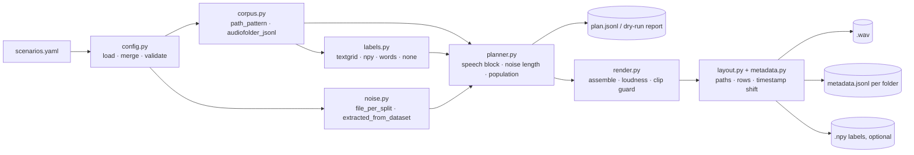

# Plan 2: Generalize the LibriVAD builder so it can build SkylarDataset's noisy subset

| | |
|---|---|
| Sequence | Plan 1 `/mnt/HD1TB/skylar-dataset/docs/plans/01-restructure-skylar-dataset.md` → **Plan 2 (this file)** → Plan 3 `/mnt/HD1TB/skylar-dataset/docs/plans/03-noisy-subset-with-librivad.md` |
| Replaces | `docs/generalization_plan.md` (v1, moved here with `git mv` and rewritten) |
| Outcome | A config-driven builder in `librivad.generation`. It reads either a LibriSpeech-style corpus or an AudioFolder corpus described by `metadata.jsonl` (the skylar `clean` subset). It renders scenario outputs into any folder layout, with a `metadata.jsonl` per folder, and still reproduces the paper's `LibriSpeechConcat` as the `middle` scenario. |
| Not in this plan | Running the build for SkylarDataset, validating it, and publishing it (Plan 3). Producing clean audio, splits and word timestamps (Plan 1). |
| Status | Phase 0 done. Nothing else is implemented. |

The scenario config format starts from
[`concat_scenarios.example.yaml`](../concat_scenarios.example.yaml). Phase 9
updates that file to version 2 (§5).

---

## 0. What changed since v1

v1 was written before SkylarDataset was designed. These changes come from the conversation since then:

| Topic | v1 | v2 | Origin |
|---|---|---|---|
| Target corpora | LibriSpeech, plus a generic CSV manifest | Also an AudioFolder corpus described by `metadata.jsonl` (`audiofolder_jsonl`), which is the Plan 1 contract | Your decision: build skylar first, then generalize using it as the example |
| Noise length | `noise_ratio` sweep, `noise_len = floor(S·p/(1−p))` | Also **fill to a fixed total**: `noise_len = T·sr − S`, with T = 30 s. The ratio then follows from the source length. | Your noisy design: "r_00 … has 30 s" |
| Loudness grid | `noise_level_db: [-30, -20, -10, 0]` | `snr_db: [0, 5, …, 35]`, the noise level below the speech level. **Noise never louder than the source** is a validation rule. | Your rule: "The noise loudness must be equal or less to the original" |
| Labels | TextGrid, `.npy` or none | Also `words`: word timestamps read from the metadata row | Plan 1 stores `words` in each row |
| Output layout | `ratio_<r>/level_<l>dB/`, `{scenario}_{index}.wav`, one `manifest.csv` | Path templates, e.g. `{split}/{scenario}/{noise}/snr_{snr_db:02d}/{language}/{duration_bucket}/{id}.wav`, with one AudioFolder `metadata.jsonl` per configurable folder level | Layout agreed for `noisy`, and load-tested with `datasets` 3.6.0 and 5.1.0 |
| Noise excerpt | Sequential cursor across files (offsets depend on file order) | `random_offset` **seeded per output group** (source id, scenario, noise kind), so every level of a file uses the same excerpt. The sequential cursor stays for `middle`. | Proposed for level comparisons |
| Normalization | Peak normalization always, as `lf.scale_signal` does | Configurable. `none` plus a clipping guard for the skylar scenarios; `peak` for `middle` | Proposed: peak normalization would change the level the 0 dB case is defined at |
| How many files | Every sweep variant for every file | **Population policy** per split: which factors are crossed (every value per file) and which are assigned (one balanced value per file) | File-count math in Plan 3 §3 |
| Timestamps | not handled | `words` (and `segments`, if present) shifted by the speech offset. Whisper-only fields dropped. | Your timestamp-shift example, corrected |
| Paper scenario name | `paper_middle` | `middle` | Your edit to the YAML |
| Python | | LibriVAD needs 3.14: it uses PEP 758 `except A, B:` syntax at [librispeech_functions.py:172](../../src/librivad/generation/librispeech_functions.py#L172) and [create_labels.py:186](../../src/librivad/generation/creation_scripts/create_labels.py#L186). skylar-dataset must stay below 3.14 while it uses `datasets` 3.6. So the two talk through a **CLI and files** (§7), not imports. | Found while planning |

---

## 1. Decisions

| ID | Decision | Options | Recommendation | Blocks |
|---|---|---|---|---|
| G1 | Config schema library | `pydantic`, or `dataclasses` with hand-written checks | **pydantic**. Validation is most of this layer's value, and skylar-dataset already uses it. | P1 |
| G2 | Folder names for sweeps | readable names or a hash per variant | **Readable**, through path templates | P5 |
| G3 | Continuity grouping for LibriSpeech `contiguous` | `[speaker, chapter]` or `[speaker]` | **`[speaker, chapter]`** | P4 |
| G4 | `post_mixing` | mix over the whole file, or skip the inserted noise block | **Whole file**, as the paper does. Not needed for skylar. | P8 |
| G5 | Canonical level key | `snr_db` (≥ 0 means noise below speech) or v1's `noise_level_db` (= −SNR) | **`snr_db`.** It matches the `snr_XX` folders, and the v1 key was never implemented. | P1 |
| G6 | Shortest noise allowed when filling to 30 s | `min_noise_s` | **2.0 s.** Sources longer than 28 s are skipped for these scenarios and reported. Your call. | P4 |
| G7 | `.npy` label files for skylar outputs | write or not | **Not.** The shifted `words` in the metadata carry the labels. LibriSpeech scenarios keep writing `.npy` for the existing VAD scripts. | P5 |
| G8 | Noise source for LibriSpeech scenarios: `dataset_silence` or `files/Noises` | | **Left open** (asked in conversation, not answered). It does not block skylar. | none |
| G9 | Module name for the corpus adapter | v1 said `datasets.py` | **`corpus.py`**, so it is not confused with Hugging Face `datasets` in imports and tracebacks | P2 |

Already decided, not reopened here:
- Scenarios `noise_first` = [noise, speech] and `noise_last` = [speech, noise].
- A fixed 30 s total for skylar.
- Levels from 0 to 35 dB below the source, in 5 dB steps.
- Noise never louder than the source.
- Folder order `{split}/{scenario}/{noise}/snr_XX/{lang}/{bucket}`.
- A `metadata.jsonl` in each language folder.
- `noisy` inherits its splits from `clean`.

---

## 2. Current state and what blocks generalization

v1's table, plus the items found since.

| Coupling | Where | Why it blocks |
|---|---|---|
| Layout fixed to `wav1 + silence + wav2` | [`create_LibriSpeechConcat.py:115`](../../src/librivad/generation/creation_scripts/create_LibriSpeechConcat.py#L115) | No way to put the noise first or last |
| Gap length fixed to `(len1 + len2) / 4` | [`:98`](../../src/librivad/generation/creation_scripts/create_LibriSpeechConcat.py#L98), [`:179`](../../src/librivad/generation/creation_scripts/create_LibriSpeechConcat.py#L179) | No ratio and no target duration |
| Gap gain fixed to `0.001` (absolute) | [`:115`](../../src/librivad/generation/creation_scripts/create_LibriSpeechConcat.py#L115) | The level is not relative to the speech |
| Pairs are always `(0,1), (2,3), …` of the sorted paths | [`:165`](../../src/librivad/generation/creation_scripts/create_LibriSpeechConcat.py#L165) | Pairs cross speakers and chapters without control |
| Labels rebuilt from the `A_+_B.wav` filename and the `/4` rule | [`create_labels.py:170`](../../src/librivad/generation/creation_scripts/create_labels.py#L170) | Any new layout silently gets wrong labels |
| Source paths parsed from the filename | [`validate.py:46`](../../src/librivad/generation/validate.py#L46) | Same |
| Label path inferred from `wav_path.parts[-5]` | [`librispeech_functions.remove_silence`](../../src/librivad/generation/librispeech_functions.py#L148) | `create_LibriVAD.py` only works with the LibriSpeech label layout |
| Speaker, chapter and utterance taken from path positions | `librispeech_functions.find_alignment`, `create_labels.py` | Assumes LibriSpeech folders |
| Labels only from TextGrids | `librispeech_functions.find_timeframes` | Other corpora come with other label formats, or none |
| One noise cursor shared by every file of a batch | [`create_LibriVAD.py:254`](../../src/librivad/generation/creation_scripts/create_LibriVAD.py#L254)–275 | The excerpt a file gets depends on processing order |
| Peak normalization of every output | [`create_LibriVAD.py:279`](../../src/librivad/generation/creation_scripts/create_LibriVAD.py#L279), [`librispeech_functions.scale_signal`](../../src/librivad/generation/librispeech_functions.py#L11) | Changes the absolute level the 0 dB case is defined at |
| Output path `Results/<dataset>/<split>/<noise>/<snr>/` | [`create_LibriVAD.py:286`](../../src/librivad/generation/creation_scripts/create_LibriVAD.py#L286) | One fixed layout, no metadata |
| Noise list, SNR list and sample rate hard-coded | [`:329`](../../src/librivad/generation/creation_scripts/create_LibriVAD.py#L329), [`:311`](../../src/librivad/generation/creation_scripts/create_LibriVAD.py#L311), [`:204`](../../src/librivad/generation/creation_scripts/create_LibriVAD.py#L204) | Not configurable |
| Python 3.14-only syntax | see §0 | skylar-dataset cannot import `librivad` |

Noise recordings available in `files/Noises/`. Each kind has
`<Kind>_noise_{train,val,test}.wav`, so the noise is already split, at 16 kHz:
`Babble`, `SSN`, `Domestic`, `Nature`, `Office`, `Public`, `Street`,
`Transport`, `City`. Domestic, Nature, Office, Public, Street and Transport
come from DEMAND, built by `create_DEMAND_noises.py`.

---

## 3. Design principles

- **Plan, then render.** Build a complete, JSON-serializable list of `FileSpec`s first: sources, segment bounds, noise file and offset, gains, output path, metadata row. Then render in parallel. This gives `--dry-run`, counts, disk estimates and limit checks before anything is written.
- **The corpus is described by config and a file format, never by code.** There are two adapters, `path_pattern` (LibriSpeech) and `audiofolder_jsonl` (skylar). No `if dataset == …` anywhere.
- **Each file is deterministic by itself.** Every random choice for an output comes from a hash of `(seed, source id, scenario, noise kind)`, never from its position in a list. So resuming, `--limit`, building one split, or changing the worker count produce byte-identical files. `middle` keeps the sequential cursor, only for parity.
- **Conditions are both folders and columns.** Every value in a path template is also a metadata field, so filtering by column and browsing by folder agree.
- **Labels and timestamps are written with the audio,** from the same `FileSpec`. A filename is never parsed to rebuild them.
- **Inputs are read-only.** The builder never writes under the input corpus root.
- **The paper dataset is a regression test.** `middle` must reproduce `files/datasets/LibriSpeechConcat` before any new scenario is trusted.
- **Old entry points keep working** until parity. Then `create_LibriSpeechConcat.py` becomes a wrapper.

---

## 4. Target architecture



New modules under `src/librivad/generation/`:

| Module | Responsibility | Main types and functions |
|---|---|---|
| `config.py` | Load the YAML, deep-merge each scenario over `defaults`, check every rule in §5.3, expand the scenario × condition grid | `load_config(path) -> Config`, `conditions(config) -> list[Condition]` |
| `corpus.py` | List the source files of a split, with their fields, sample count and labels source | `SourceItem(id, path, split, fields, n_samples, row)`, `CorpusAdapter.items(split)`, `.continuity_groups(split)` |
| `labels.py` | A sample-level 0/1 array per source item | `load_labels(item, cfg) -> NDArray[np.int8]` |
| `noise.py` | Resolve noise sources and cut excerpts | `NoiseSource.excerpt(n, key) -> (offset, NDArray)`, `NoiseSource.sequential(n, cursor)` |
| `planner.py` | Speech blocks, noise length, skip rules, population expansion, `FileSpec` | `plan(config, adapter, noises) -> Iterator[FileSpec]`, `DryRunReport` |
| `render.py` | Read the sources, place the blocks, measure loudness, scale, fade, clip guard, int16 | `render(spec) -> Rendered(audio, labels, measured)` |
| `layout.py` | Fill the path templates, write files atomically, one metadata writer per folder, resume | `OutputLayout.path(spec)`, `MetadataWriter`, `existing_outputs(root)` |
| `metadata.py` | Build the output row: carry fields over from the source, add condition fields, shift timestamps | `build_row(spec, rendered, source_row) -> dict`, `shift_timestamps(row, offset_s)` |
| `build_scenarios.py` | CLI (§7) | `main()` |

`librispeech_functions.py` stays as a compatibility layer. Once `labels.py` and
`noise.py` exist, its functions become thin wrappers over them.

---

## 5. Config format, version 2

### 5.1 Skylar noisy scenarios (the config Plan 3 generates)

```yaml
version: 2
seed: 1234

dataset:
  name: skylar_clean
  adapter: audiofolder_jsonl
  root: /mnt/HD1TB/skylar-dataset/outputs/SkylarDataset/clean
  schema_version: 1                       # must equal .provenance/schema.json (Plan 1 §7)
  sample_rate: 16000                      # every file is checked, never resampled here
  splits: {train: train, val: val, test: test}
  metadata_glob: "{split}/*/metadata.jsonl"
  id_field: id
  passthrough_fields: [language, duration_bucket, text, speaker, dnsmos, dataset, component, locale, source_id, source]
  labels:
    source: words
    field: words
    bridge_gaps_ms: 0                     # gaps between words shorter than this count as speech; 0 keeps every pause
  continuity: null                        # no utterance is a continuation of another

noise_sources:                            # one entry per kind; path has {split}
  babble:    {type: file_per_split, path: /mnt/HD1TB/LibriVAD/files/Noises/Babble_noise/Babble_noise_{split}.wav}
  ssn:       {type: file_per_split, path: /mnt/HD1TB/LibriVAD/files/Noises/SSN_noise/SSN_noise_{split}.wav}
  office:    {type: file_per_split, path: /mnt/HD1TB/LibriVAD/files/Noises/Office_noise/Office_noise_{split}.wav}
  # domestic, nature, public, street, transport, city: same pattern

output:
  root: /mnt/HD1TB/skylar-dataset/outputs/SkylarDataset/noisy
  path: "{split}/{scenario}/{noise}/snr_{snr_db:02d}/{language}/{duration_bucket}/{id}.wav"
  metadata_dir: "{split}/{scenario}/{noise}/snr_{snr_db:02d}/{language}"
  metadata_format: audiofolder_jsonl      # file_name relative to metadata_dir
  write_npy_labels: false                 # G7
  dtype: int16
  normalization: none                     # none | peak
  clip_guard: per_group                   # per_group | per_file | off (§6.5)
  drop_fields: [seek, tokens, temperature, compression_ratio]   # Whisper-only fields, if a source has them
  limits: {max_files_total: 100000, max_files_per_folder: 10000}

defaults:
  speech_block: {composition: single}
  noise_length: {mode: fill_to_target, target_duration_s: 30, min_noise_s: 2.0}   # G6
  noise_block: {slicing: random_offset, key: [id, scenario, noise], fade_ms: 10}
  loudness: {measure: rms, speech_only: true, min_speech_s: 0.5}
  constraints: {min_snr_db: 0}            # noise never louder than the source

scenarios:
  - {name: noise_first, layout: [noise, speech]}
  - {name: noise_last,  layout: [speech, noise]}

conditions:
  noise: [babble, ssn, domestic, nature, office, public, street, transport, city]
  snr_db: [0, 5, 10, 15, 20, 25, 30, 35]

population:                               # factors: scenario, noise, snr_db
  train: {crossed: [],                 assigned: [scenario, noise, snr_db]}
  val:   {crossed: [snr_db],           assigned: [scenario, noise]}
  test:  {crossed: [snr_db, scenario], assigned: [noise]}
  strata: [language, duration_bucket]     # assigned values are balanced inside each stratum
```

`{id}` in `path` is the clean sample id. Keeping it as the file name is what
makes pairing a path swap: `clean/<split>/<lang>/<bucket>/<id>.wav` becomes
`noisy/<split>/<scenario>/<noise>/snr_XX/<lang>/<bucket>/<id>.wav`.

### 5.2 LibriSpeech scenarios

`concat_scenarios.example.yaml` keeps its structure, with these changes:
- `version: 2`.
- `noise_level_db` becomes `snr_db`, with values negated.
- `noise_ratio` moves under `noise_length: {mode: ratio, noise_ratio: …}`.
- `output.filename` becomes `output.path`.
- `middle` keeps `slicing: sequential_wrap`, `loudness: fixed_gain 0.001`, `normalization: peak` at 0 dBFS and path `{partition}/{first}_+_{last}.wav`.

The two open questions from that YAML stay as they are: where LibriSpeech scenarios take their noise from (G8), and `post_mixing`.

### 5.3 Validation rules

v1 rules:
- `layout` has exactly one `noise`, and `speech` once or twice.
- `contiguous` requires `continuity`.
- Fields used in `group_by`, continuity or `path` must exist.
- `extracted_from_dataset` requires labels other than `none`.
- `post_mixing` together with `ratio_basis: segment` warns.

New rules:
- `noise_length.mode: ratio` requires `0 ≤ noise_ratio < 1`.
- `fill_to_target` requires `target_duration_s > min_noise_s ≥ 0`.
- Every `snr_db` must be ≥ `constraints.min_snr_db`, when that constraint is set.
- `loudness.measure: fixed_gain` excludes `snr_db`.
- Every name in `population.*.crossed` and `assigned` is a factor (`scenario` or a key of `conditions`). Each factor appears exactly once per split, in either crossed or assigned.
- Every placeholder in `output.path` and `output.metadata_dir` is a source field (`id_field`, `passthrough_fields`), a factor, or `split`.
- `metadata_dir` must render to a parent folder of the path's folder.
- `labels.source: words` requires `labels.field` to be in the source rows.
- `dataset.schema_version` must match the corpus's `.provenance/schema.json`.
- Every key of `conditions.noise` must exist in `noise_sources`.

---

## 6. Core rules

### 6.1 Noise length

| Mode | Formula (integers, samples) | Notes |
|---|---|---|
| `ratio` | `noise_len = floor(S · p / (1 − p))` with `Fraction(p).limit_denominator()` | v1. A float gets 0.6 and 0.7 wrong by one sample for many `S` (measured). p = 0.2 equals the paper's `int((len1+len2)/4)`. |
| `fill_to_target` | `noise_len = T · sr − S` | Skip the item with reason `too_long` when `noise_len < min_noise_s · sr`. Total = exactly `T · sr` samples. |

`S` is the source's frame count, read from the WAV header, not its
`duration` field. `noise_ratio = noise_len / total` is recorded in the row.

### 6.2 Loudness

```
speech = source[labels == 1]                         # from words; all samples when labels are none
skip with reason "too_little_speech" when len(speech) < min_speech_s · sr
ref_rms   = RMS(speech)
noise_rms = RMS(excerpt)                             # whole excerpt, before fades; skip if 0
gain      = ref_rms · 10 ** (−snr_db / 20) / noise_rms
```

- `snr_db = 0` means the noise RMS equals the speech-only RMS of the source. That is your `r_00` case.
- `snr_db = 35` means 35 dB below. For reference, the clean LibriSpeechConcat middle segments measured 42–49 dB below speech in this session.
- The formula is [`create_LibriVAD.py:277`](../../src/librivad/generation/creation_scripts/create_LibriVAD.py#L277) applied to a block placed next to the speech instead of mixed over it.
- Speech-only RMS needs the labels. Measuring over the whole file would make the noise too quiet for sources with long pauses.

### 6.3 Excerpt choice

- `random_offset` uses `rng = default_rng(int.from_bytes(sha256(f"{seed}:{id}:{scenario}:{noise}").digest()[:8], "big"))`, then `offset = rng.integers(0, len(noise_file) − noise_len)`. `snr_db` is not in the key, so every level of a file uses the **same excerpt** and differs only by gain.
- Each split uses its own noise file (`{split}` in the path), so train, val and test never share noise audio.
- When a noise file is shorter than `noise_len`, tile it, as `create_LibriVAD.py` does with `np.tile`, and warn.

### 6.4 Assembly and fades

- Place the blocks in `layout` order. The speech samples are copied **unchanged**.
- A raised-cosine fade of `fade_ms` is applied only to the noise block, at its edge next to the speech. The speech and its timestamps are untouched.
- Labels: 0 over the noise block, the source labels over the speech block. Assert `len(labels) == len(audio)`.

### 6.5 Clipping guard (replaces peak normalization for skylar)

- After assembly in float, if `max|x| > 0.999`, scale **the whole file** by `0.999 / max|x|` and record `clip_gain_db`. The relative level is kept; the absolute level changes.
- With `per_group` (the default), the guard gain is computed over every crossed level of the same `(id, scenario, noise)` group, using the loudest, and applied to all of them. The speech is then at the same absolute level in every `snr_XX` folder of that file, which keeps level comparisons clean.
- Convert to int16 with `round(x · 32767)`.
- `middle` keeps `normalization: peak` for parity.

### 6.6 Timestamps and the metadata row

- `speech_start = noise_len / sr` for `[noise, speech]`, `0` for `[speech, noise]`.
- `shift_timestamps` adds `speech_start` to every `start` and `end` in `words`, and in `segments` when present. It rounds to 3 decimals, leaves `word` and `probability` as they are, and removes `drop_fields` at every nesting level.
- A worked example from the conversation:
  - A 1.42 s source in a 30 s `noise_first` file gets `speech_start = 28.58`. The word "I" (0.00–0.22) becomes 28.58–28.80.
  - The offset comes from the frame count. It is never taken from the last timestamp, because a source with trailing silence would land in the wrong place.
- Noisy row fields:

| Field | Value |
|---|---|
| `file_name` | path relative to `metadata_dir`, e.g. `10-15/<clean id>.wav` |
| `id` | `<clean id>-<scenario>-<noise>-<snr:02d>`, unique in the subset |
| `clean_id` | the source `id` |
| `scenario`, `noise`, `snr_db` | the condition |
| `duration` | `T`, e.g. 30.0 |
| `source_duration` | `S / sr` |
| `speech_start`, `speech_end`, `noise_start`, `noise_end` | seconds |
| `noise_ratio` | `noise_len / total` |
| `noise_file`, `noise_offset_s` | provenance of the excerpt |
| `noise_gain_db`, `clip_gain_db` | applied gains |
| `measured_snr_db` | `20·log10(ref_rms / RMS(noise block without fades))` |
| `words`, `segments` | shifted |
| passthrough fields | `language`, `duration_bucket` (of the **source**), `text`, `speaker`, … |

### 6.7 Population

For each source item of a split:
- Take every combination of the **crossed** factors.
- Take one combination of the **assigned** factors. It is chosen by walking a seeded shuffle of their Cartesian product, round-robin, inside each stratum (`language`, `duration_bucket`), in the item's sorted-id order. So inside a stratum the counts of any two assigned combinations differ by at most one.
- Full factorial is "everything crossed". One condition per file is "everything assigned".

The dry run reports the counts per factor value, per stratum and per folder.

### 6.8 Determinism and resume

- The plan is a pure function of config, corpus and noise files. The same inputs give a byte-identical `plan.jsonl`.
- Rendering skips any `FileSpec` whose wav and metadata row both exist. Orphans (a wav without a row) are moved to `.orphans/`, and `.tmp` files are deleted, the same rules as Plan 1 Step 6.
- One `MetadataWriter` thread per run appends the rows, so parallel renderers never interleave lines.

---

## 7. CLI, the contract with skylar-dataset

```bash
uv run --project /mnt/HD1TB/LibriVAD python -m librivad.generation.build_scenarios \
    --config <scenarios.yaml> [--dry-run] [--report report.json] \
    [--scenario NAME]... [--split train|val|test]... [--limit N] [--workers N] [--overwrite] [--check]
```

| Flag | Purpose |
|---|---|
| `--dry-run` | Plan only. Write `plan.jsonl` next to `--report`, and print counts, durations, disk and limit checks. |
| `--report PATH` | JSON summary: LibriVAD git commit, config hash, counts per split and condition, skips by reason, files written or skipped, max files per folder, bytes, time taken, limit status |
| `--check` | Re-validate existing outputs against the plan without rendering. Lengths, rows, measured SNR, labels. |
| `--limit N` | First N specs per condition, for listening checks |
| `--workers N` | Rendering threads |
| `--overwrite` | Re-render files that exist |

Exit codes:

| Code | Meaning |
|---|---|
| 0 | success |
| 2 | invalid config |
| 3 | limits exceeded (only `--dry-run` or a build without `--allow-over-limits`) |
| 4 | the input corpus breaks the contract (schema version, sample rate, missing rows) |
| 1 | anything else |

skylar-dataset calls this as a subprocess and reads only `--report` and the
output folder. It never imports `librivad`, so each project keeps its own
Python version and dependencies. Moving to an in-process call is possible only
once skylar runs on Python 3.14 with `datasets` ≥ 4 and torchcodec. That
combination loaded the mock layouts correctly in this session, but streaming
the three sources with it was not tested.

---

## 8. Phases

Each phase ends with passing tests and can be merged on its own. "Synthetic
corpus" means a fixture built in `tmp_path`: a few short WAVs, plus rows written
exactly as Plan 1's writer writes them, `schema.json` included.

### Phase 0: Package reorganization ✅

Done and committed (d27807c). `generation/` and `vad/`, lowercase module names, imports, `.env`, `scripts/main_vit.sh`, tests and docs updated. 19 tests, `ruff check` and `ty check` passed.

### Phase 1: Config

- Add `pydantic` and `pyyaml` (G1).
- Models for §5, the deep merge (scenario over `defaults`, dicts merged at every level, lists replaced), path resolution relative to `PROJECT_ROOT`, and the condition grid.
- **Tests:**
  - Load both example configs.
  - One failing config per rule in §5.3, each with a clear message.
  - Merged values per scenario.
  - Grid size: 2 scenarios × 9 noises × 8 levels = 144 conditions.

### Phase 2: Corpus adapters and labels

- `corpus.py`:
  - `path_pattern`: the pattern becomes a regex with named groups; `exclude_list`; continuity grouping and ordering.
  - `audiofolder_jsonl`:
    - Read each `metadata.jsonl` matched by `metadata_glob`, and resolve `file_name` against its folder.
    - Check `schema_version`, the sample rate and mono with `soundfile.info`, and `duration` against the frames (±1 sample).
    - Ids must be unique.
    - Any violation exits with code 4.
- `labels.py`:
  - `textgrid` (the generalized `find_timeframes`), `npy`, `none`.
  - `words`: `label[floor(start·sr) : ceil(end·sr)] = 1` for each word, then fill gaps shorter than `bridge_gaps_ms`.
- **Tests:**
  - TextGrid labels equal `create_labels` output for 5 real LibriSpeech files. Skipped without `files/`.
  - `words` labels on hand-made rows, boundary samples included.
  - The adapter rejects a row whose wav is 24 kHz.

### Phase 3: Noise sources

- `file_per_split`: check 16 kHz and mono when opened, and memory-map long files.
- `extracted_from_dataset`: v1's `generate_silence_signal` with a cache.
- Slicing: `random_offset` keyed as in §6.3, and `sequential_wrap` with an explicit cursor for `middle`. Raised-cosine fades.
- **Tests:**
  - The same key gives the same offset.
  - A different `snr_db` gives the same excerpt.
  - A different noise or scenario gives a different offset.
  - Wrap-around equals the current `np.tile` behavior.
  - No discontinuity at fade edges.

### Phase 4: Planner

- Compositions: `single` for skylar; `contiguous` and `concatenate` with `group_by` and `max_utterances` for LibriSpeech.
- Noise length modes (§6.1), skip reasons (`too_long`, `too_little_speech`), population (§6.7).
- `FileSpec` serializes to JSON.
- `DryRunReport`: counts per split, condition and stratum; total files; maximum files in one folder; bytes, as Σ total samples × 2 plus 44 per file; limit status.
- **Tests:**
  - Count formula: items × Π|crossed| per split.
  - Assigned balance within a stratum (max − min ≤ 1).
  - The same plan twice is byte-identical.
  - `--split test` alone gives the same specs as the test part of a full plan.
  - Skip rules at the boundary (`S = 28 s` with `min_noise_s = 2`).

### Phase 5: Render, layout, metadata, CLI

- `render.py` (§6.2–6.5), `layout.py` (templates, atomic writes, resume, one metadata writer), `metadata.py` (§6.6), `build_scenarios.py` (§7), disk check reusing `check_disk_space`.
- Each rendered file is checked before it is written:
  - the length equals the plan;
  - `|measured_snr_db − snr_db| ≤ 0.1`;
  - labels have the audio's length;
  - no sample at ±32767 unless `clip_gain_db` was applied.
- **Tests, end to end on the synthetic corpus:**
  - Every output is exactly `30·16000` samples.
  - The speech block is bit-identical to the source when `clip_gain_db == 0`.
  - Shifted words equal source words plus `speech_start` (±0.5 ms).
  - Rows are valid JSONL with stable types.
  - Resume renders nothing new, and `--workers 1` and `--workers 8` give identical bytes.

### Phase 6: Parity with the paper dataset

- Run `middle` on dev-clean and test-clean, and compare with `files/datasets/LibriSpeechConcat` and `files/Labels/LibriSpeechConcat`. Expected: same names and sample counts, identical labels, audio within ±1 LSB.
- Make it a slow test (`@pytest.mark.slow`), skipped when `files/` is missing.
- Then turn `create_LibriSpeechConcat.py` into a wrapper. `setup.py` keeps calling it unchanged.

### Phase 7: Skylar-shaped golden test

- A fixture with 3 items per (language, split) and the exact Plan 1 schema, rendered with the §5.1 config cut down to 2 noises and 3 levels.
- Check the folder tree against `noisy/{split}/{scenario}/{noise}/snr_XX/{lang}/{bucket}/{id}.wav`, and that each language folder has one `metadata.jsonl`.
- Check the population counts per split, and the paired excerpts across levels: normalized cross-correlation of the noise blocks ≥ 0.9999.
- Loading with `datasets` is tested in Plan 3, on the skylar side. LibriVAD does not take `datasets` as a dependency for this.

### Phase 8: `create_LibriVAD.py` refactor and `post_mixing` (optional for skylar)

Take labels from the metadata or `labels_root` instead of `remove_silence`'s path guessing, accept scenario output folders as input, and implement `post_mixing` (G4).

### Phase 9: Documentation

- Usage guide for the builder.
- Update `concat_scenarios.example.yaml` to version 2 (§5.2).
- Add `configs/scenarios/skylar_noisy.example.yaml` (§5.1).
- Update `parameters_configuration.md` and `librispeech_vs_librispeechconcat.md`.
- Rename "Noise (Silence)" to "Silence" in `docs/images/librispeechconcat.svg`.

### Phase 10: Issues that predate this plan

Fix them along the way:
- **Formatting.** `ruff format --check` fails on `vad/auc_bdnn.py`, `vad/auc_vit.py`, `vad/kwt3_vad.py` and `tests/test_auc_bdnn.py`.
- **`create_city_noise.py` does not import on Python 3.14.** `pydub` needs `pyaudioop`.
- **Undeclared dependencies.** `scikit-learn` and `joblib` are imported by `vad/` but not declared.
- **Duplicated helpers.** `uW_context`, `LRcontext` and `enframe` are duplicated in `vad/auc_bdnn.py` and `vad/auc_vit.py`; move them to a shared `vad/framing.py`.
- **Stale VAD docs.** `docs/vad_models_and_evaluation.md` names functions that do not exist (`kwt_from_name`, `ComputeErrorRates`), and its line anchors are out of date.
- **Misleading commit message.** Commit d27807c, which holds the reorganization, says "Add KWT model and MFCC…". This is only a note for the history; nothing to fix in code.

---

## 9. Estimates

| Item | Estimate | Basis |
|---|---|---|
| Planning about 12.6k skylar sources × the Plan 3 population | seconds | header reads only (`soundfile.info`) |
| Rendering about 26.5k files of 30 s (Plan 3 §3) | ≈ 25 GB of writes; 10–30 min on this HDD | CPU per file is small (RMS, scale, write). The disk is the limit. |
| Phase 6 parity on dev and test | minutes | 2,661 pairs |

---

## 10. Out of scope

- `rttm` and `energy_vad` label sources.
- LUFS loudness. Speech-only RMS is used because the labels exist.
- Resampling. Inputs must already be at `sample_rate`; skylar resamples in Plan 1.
- More than one noise block per file.
- Mixing noise into training data on the fly. `render()` is a pure function, so a DataLoader could call it later, once the Python boundary in §7 is resolved.
