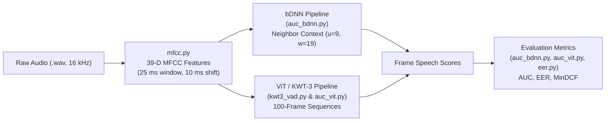

# VAD Features, Models, and Evaluation Modules

This guide provides an accessible explanation of the five core feature-extraction, modeling, and evaluation files in [`src/librivad/vad/`](../src/librivad/vad/), grounded in the reference paper: **[LibriVAD: A Scalable Open Dataset with Deep Learning Benchmarks for Voice Activity Detection](LibriVAD_2512.17281v1.pdf)** (Stylianou et al., 2025).

---

## High-Level Pipeline Overview

In the LibriVAD paper (Section 3), a Voice Activity Detection (VAD) system takes an audio signal and predicts, for every **10 ms frame**, whether human speech is present (`1`) or absent (`0`).

| File | Role in the LibriVAD Paper | Paper Section |
| :--- | :--- | :--- |
| [`src/librivad/vad/mfcc.py`](../src/librivad/vad/mfcc.py) | Extracts Mel-Frequency Cepstral Coefficients (MFCC) from `.wav` audio. | §3.1, §3.4 |
| [`src/librivad/vad/kwt3_vad.py`](../src/librivad/vad/kwt3_vad.py) | Defines and trains the **Vision Transformer (ViT / KWT-3)** architecture for frame-level VAD. | §3.2, §3.4 |
| [`src/librivad/vad/auc_bdnn.py`](../src/librivad/vad/auc_bdnn.py) | Expands frames with left/right context for the **bDNN** baseline and computes AUC, accuracy, and EER. | §3.2, §3.3, §3.4 |
| [`src/librivad/vad/auc_vit.py`](../src/librivad/vad/auc_vit.py) | Splits utterances into 100-frame sequences for **ViT** inference and computes AUC, accuracy, and EER. | §3.2, §3.3 |
| [`src/librivad/vad/eer.py`](../src/librivad/vad/eer.py) | Computes **Equal Error Rate (EER)** and **Minimum Detection Cost Function (MinDCF)** using NIST SRE 2008 costs. | §3.3, §4.4 |

---

## 1. [`mfcc.py`](../src/librivad/vad/mfcc.py) — Acoustic Feature Extraction

### What It Does (Plain English)
Raw audio waveforms contain thousands of samples per second (16,000 samples/sec at 16 kHz), which is noisy and redundant for direct frame classification. [`mfcc.py`](../src/librivad/vad/mfcc.py) converts a waveform into compact **Mel-Frequency Cepstral Coefficients (MFCCs)** that mimic how the human ear perceives sound frequencies (the Mel scale).

### Grounding in the Paper (§3.1 & §3.4)
- **Windowing:** 25 ms Hamming window (`winlen = 0.025`) with a 10 ms frame shift (`ovrlen = 0.01`).
- **Pre-emphasis:** High-frequency boosting with coefficient `0.97` (`preemph = 0.97`).
- **Filter Bank:** 24 Mel-frequency triangular filters (`nfilter = 24`) across a 512-point FFT (`ndft = 512`).
- **Cepstral Coefficients:** 12 static coefficients ($C_{1\text{--}12}$) plus log-energy (replaced into $C_0$). In the full feature pipeline, first- ($\Delta$) and second-order ($\Delta\Delta$) derivatives are appended to form **39-dimensional** feature vectors per frame, normalized to zero mean and unit variance per utterance.

### Key Functions
- [`speech_wave(fileName_)`](../src/librivad/vad/mfcc.py#L14-L17): Reads a 16-bit PCM `.wav` file and normalizes sample amplitudes to `[-1.0, 1.0)`.
- [`enframe(x, win, inc)`](../src/librivad/vad/mfcc.py#L20-L53): Slices a 1D audio signal `x` into overlapping 2D frames of length `win` stepped by `inc`.
- [`mfcc(s, fs, ...)`](../src/librivad/vad/mfcc.py#L56-L104): Runs DC removal, pre-emphasis (`0.97`), Hamming windowing, FFT, Mel filter bank projection, log compression, Discrete Cosine Transform (DCT), and cepstral liftering.
- [`mel_filter_bank(fs, nfft, lowfreq, maxfreq, nfilter)`](../src/librivad/vad/mfcc.py#L107-L157): Builds the matrix of 24 triangular filters spaced evenly on the Mel scale (via [`mel`](../src/librivad/vad/mfcc.py#L160-L161) and [`invmel`](../src/librivad/vad/mfcc.py#L164-L165)).
- [`dct_matrix(n)`](../src/librivad/vad/mfcc.py#L168-L176) & [`ceplifter(N, L)`](../src/librivad/vad/mfcc.py#L179-L183): Compute the orthogonal DCT-II matrix and sinusoidal liftering weights to decorrelate and smooth the cepstral coefficients.

---

## 2. [`kwt3_vad.py`](../src/librivad/vad/kwt3_vad.py) — Vision Transformer (ViT / KWT-3) for VAD

### What It Does (Plain English)
Originally designed for image classification, a **Vision Transformer (ViT)** splits an image into patches and uses self-attention to learn how every patch relates to every other patch. In LibriVAD, the authors adapt the **Keyword Transformer (KWT-3)** architecture to VAD for the first time:
- A 100-frame sequence of 39-D acoustic features (`[100, 39]`, representing 1 second of audio) is treated as an "image."
- Each individual 10 ms frame (`[1, 39]`) is treated as a "patch."
- Self-attention across all 100 frames allows the model to use long-range context before and after a frame to decide whether it contains speech or noise.

### Grounding in the Paper (§3.2 & §3.4)
- **Sequence & Patch Size:** Input resolution `[100, 39]` (`input_res`), patch size `[1, 39]` (`patch_res`) $\rightarrow$ 100 tokens per sequence.
- **Transformer Encoder (`kwt-3`):**
  - Embedding dimension: `dim = 192`
  - Encoder depth: `depth = 12` layers
  - Multi-Head Attention: `heads = 3`, `dim_head = 64` ($3 \times 64 = 192$)
  - Feed-Forward Network (MLP): expands `192` $\rightarrow$ `mlp_dim = 768` with GELU activation
  - Output projection: `num_classes = 2` per frame (`[non-speech, speech]`)
- **Training Setup:** Optimized with AdamW (`lr = 0.001`, `weight_decay = 0.1`), batch size `32`, label smoothing `0.1`, up to `50` epochs.

### Key Classes & Functions
- [`KWT`](../src/librivad/vad/kwt3_vad.py#L142-L216): The full Vision Transformer model. Converts each `[1, 39]` frame into a 192-D embedding, adds learnable positional embeddings (`pos_embedding`), runs the [`Transformer`](../src/librivad/vad/kwt3_vad.py#L111-L139) backbone, and projects each frame to 2 output logits via `mlp_head`.
- [`Attention`](../src/librivad/vad/kwt3_vad.py#L76-L108) & [`FeedForward`](../src/librivad/vad/kwt3_vad.py#L60-L73): Multi-head self-attention and two-layer GELU MLP blocks wrapped in [`PostNorm`](../src/librivad/vad/kwt3_vad.py#L48-L57) / [`PreNorm`](../src/librivad/vad/kwt3_vad.py#L36-L45) residual normalization.
- [`kwt_from_name(name)`](../src/librivad/vad/kwt3_vad.py#L219-L264): Factory helper that instantiates `kwt-1`, `kwt-2`, or `kwt-3` presets.
- [`CustomDataset_train`](../src/librivad/vad/kwt3_vad.py#L267-L293) & [`train(...)`](../src/librivad/vad/kwt3_vad.py#L300-L338): PyTorch `Dataset` and single-epoch training loop that loads `.npy` feature/label sequences and optimizes cross-entropy loss across all frames.

---

## 3. [`auc_bdnn.py`](../src/librivad/vad/auc_bdnn.py) — bDNN Context Windowing & Evaluation

### What It Does (Plain English)
The **Boosted Deep Neural Network (bDNN)** is one of the primary baseline models benchmarked in the paper. Because a single 10 ms frame is too short to reliably separate speech from noise, bDNN "boosts" each frame by stacking its neighboring past and future frames into one wide input vector. Crucially, the network doesn't just predict the label of the center frame—it predicts the labels of **all neighboring frames in the window simultaneously**. At test time, a frame's final speech probability is computed by averaging the predictions made for it across all overlapping windows that included that frame.

### Grounding in the Paper (§3.2, §3.3 & §3.4)
- **Context Parameters:** $u = 9$ left-context frames and $w = 19$ right-context frames (sampled with a step of 3, yielding 19 context frames per window).
- **Inference Averaging:** [`bdnn_prediction`](../src/librivad/vad/auc_bdnn.py#L123-L140) slides across the multi-node output matrix and averages all predictions corresponding to the same frame index.

### Key Functions
- [`vad_for_w(vad, winlen, ovrlen)`](../src/librivad/vad/auc_bdnn.py#L58-L77): Converts sample-level binary VAD labels (at 16 kHz) into frame-level binary labels (`1` if more than 50% of samples in the 25 ms frame are speech, `0` otherwise).
- [`uW_context(u, w, step)`](../src/librivad/vad/auc_bdnn.py#L80-L92): Generates the relative frame offset indices `[-w, ..., 0, ..., +w]` using step size `3` (`u=9, w=19`).
- [`LRcontext(data, u, w, step)`](../src/librivad/vad/auc_bdnn.py#L95-L120): Expands a 2D feature or label matrix `[N_frames, D]` by concatenating the neighboring frames specified by [`uW_context`](../src/librivad/vad/auc_bdnn.py#L80-L92), clamping out-of-bounds indices at the start and end of the utterance.
- [`bdnn_prediction(Nframes, logits, u, w, step)`](../src/librivad/vad/auc_bdnn.py#L123-L140): Aggregates and averages the multi-output bDNN predictions back into a single `[N_frames, 1]` probability trajectory.
- [`cal_auc_eer(labels, logits)`](../src/librivad/vad/auc_bdnn.py#L165-L185) & [`calculate_eer(y_true, y_scores)`](../src/librivad/vad/auc_bdnn.py#L143-L162): Compute the ROC Area Under the Curve (AUC) and Equal Error Rate (EER).
- [`auc_acc(...)`](../src/librivad/vad/auc_bdnn.py#L188-L253) & [`auc_acc_bcRes(...)`](../src/librivad/vad/auc_bdnn.py#L256-L321): Run full-utterance inference on a PyTorch model and return `(auc, accuracy, logits, labels, eer)`.

---

## 4. [`auc_vit.py`](../src/librivad/vad/auc_vit.py) — ViT Sequence Splitting & Evaluation

### What It Does (Plain English)
While [`auc_bdnn.py`](../src/librivad/vad/auc_bdnn.py) prepares sliding context windows for bDNN, [`auc_vit.py`](../src/librivad/vad/auc_vit.py) prepares **100-frame chunks** for evaluating the Vision Transformer ([`kwt3_vad.py`](../src/librivad/vad/kwt3_vad.py)). Because utterances have variable lengths that aren't always multiples of 100 frames, [`auc_vit.py`](../src/librivad/vad/auc_vit.py) zero-pads the final partial chunk to 100 frames before passing it to the ViT model, and then trims off the padded frames before computing AUC, accuracy, and EER.

### Grounding in the Paper (§3.2 & §3.3)
- *"Feature vectors are split into sequences of 100 frames and passed through patching, positional encoding, and several transformer encoder blocks. The final encoder output is projected onto two output nodes corresponding to speech and non-speech classes at the frame level. For sequences or residual segments shorter than 100 frames, zero-padding is applied to ensure a consistent input length."* (Paper §3.2, p. 7)

### Key Functions
- [`split_data_into_sequences(data, labels, sequence_length=100)`](../src/librivad/vad/auc_vit.py#L143-L176): Splits `[N_frames, 39]` features and `[N_frames, 1]` labels into chunks of `100` frames. If `N_frames % 100 != 0`, the remaining frames are placed into a zero-padded `[100, 39]` tensor and `extra_frames_no` records how many valid frames are in that last chunk.
- [`auc_acc(data, model, labels, ...)`](../src/librivad/vad/auc_vit.py#L224-L295):
  1. Calls [`split_data_into_sequences`](../src/librivad/vad/auc_vit.py#L143-L176) to chunk the utterance into `[num_chunks, 100, 39]`.
  2. Runs the ViT `model` on the chunks and applies `softmax` over the 2 output classes, selecting class `1` (speech probability).
  3. Removes any trailing zero-padded frames (`pred[:len(pred) - (100 - extra_frames)]`) so the predictions align 1-to-1 with the ground-truth `labels`.
  4. Computes frame accuracy, ROC **AUC**, and **EER** via [`cal_auc_eer`](../src/librivad/vad/auc_vit.py#L201-L221).

---

## 5. [`eer.py`](../src/librivad/vad/eer.py) — NIST EER & MinDCF Scoring

### What It Does (Plain English)
Standard accuracy treats all errors equally, which can be misleading when silence and speech are imbalanced or when missing human speech is much costlier than letting a brief noise frame through. [`eer.py`](../src/librivad/vad/eer.py) computes two threshold- sweeping operating metrics from the NIST Speaker Recognition Evaluation (SRE) standard:
1. **Equal Error Rate (EER):** The exact threshold where the **Miss Rate** ($P_{\text{miss|target}}$, speech misclassified as silence) equals the **False Alarm Rate** ($P_{\text{FA|non-target}}$, noise/silence misclassified as speech). Lower is better.
2. **Minimum Detection Cost Function (MinDCF):** A weighted error score that penalizes missing speech **10 times more heavily** than false alarms. Lower is better.

### Grounding in the Paper (§3.3, Equation 3)
The Detection Cost Function is defined in Equation (3) of the paper (p. 8) following the NIST 2008 SRE evaluation plan:

$$\mathrm{DCF} = C_{\text{miss}} \times P_{\text{miss}|\text{target}} \times P_{\text{target}} + C_{\text{FA}} \times P_{\text{FA}|\text{non-target}} \times (1 - P_{\text{target}})$$

where:
- $C_{\text{miss}} = 10$ (`c_miss` in [`compute_mindcf`](../src/librivad/vad/eer.py#L112)) — cost of missing a speech frame,
- $C_{\text{FA}} = 1$ (`c_fa` in [`compute_mindcf`](../src/librivad/vad/eer.py#L113)) — cost of falsely accepting a non-speech frame,
- $P_{\text{target}} = 0.01$ (`p_target` in [`compute_mindcf`](../src/librivad/vad/eer.py#L114)) — prior probability of target speech.

### Key Functions
- [`ComputeErrorRates(scores, labels)`](../src/librivad/vad/eer.py#L17-L56): Sorts all frame scores and sweeps every possible decision threshold to return `fnrs` (False Negative / Miss rates), `fprs` (False Positive / False Alarm rates), and `thresholds`.
- [`ComputeMinDcf(fnrs, fprs, thresholds, p_target, c_miss, c_fa)`](../src/librivad/vad/eer.py#L61-L97): Evaluates the weighted NIST DCF across all thresholds and normalizes by $\min(C_{\text{miss}} P_{\text{target}}, C_{\text{FA}} (1 - P_{\text{target}}))$ to return `(min_dcf, min_c_det_threshold)`.
- [`compute_mindcf(scfile)`](../src/librivad/vad/eer.py#L100-L123): Reads a two-column `<score> <label>` file, finds the threshold where $|\text{FNR} - \text{FPR}|$ is minimized for **EER**, and calls [`ComputeMinDcf`](../src/librivad/vad/eer.py#L61-L97) with the NIST 2008 SRE parameters (`c_miss=10`, `c_fa=1`, `p_target=0.01`).
